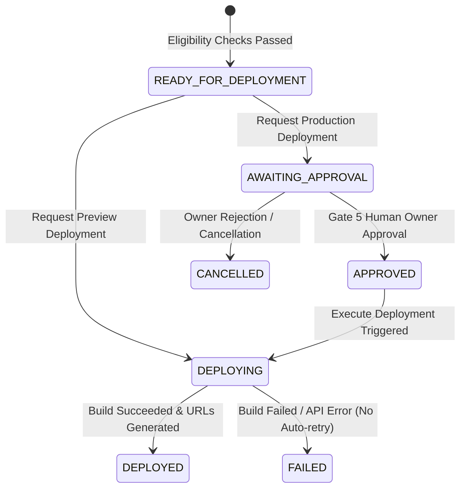

# PHASE 8 IMPLEMENTATION REPORT: PRODUCTION DEPLOYMENT AGENT & CLOUD HOSTING

**Project:** AI Web Agency Agent  
**Date:** October 2026  
**Status:** Completed & Validated ✅  
**Version:** 8.0.0

---

## 1. Executive Summary

Phase 8 implements the autonomous **Production Deployment Agent & Cloud Hosting Infrastructure** for websites generated by the Phase 6 Website Builder and verified by the Phase 7 Automated QA Agent.

The implementation strictly enforces enterprise DevOps and security best practices:
1. **Server-Side Gatekeeping:** Prevents deployment of unvalidated code, unapproved sessions, or websites with blocker/high QA defects.
2. **Gate 5 Human Owner Approval:** Production deployments unconditionally require explicit owner sign-off with audit logging before triggering external infrastructure synchronization.
3. **Secure Multi-Provider Architecture:** Pluggable GitHub (`GitHubProvider`), Vercel (`VercelProvider`), and local simulation (`MockDeploymentProvider`) integrations.
4. **Non-Destructive Git Sync & Security Screening:** Pre-commit scanning for secrets (API keys, JWTs, AWS credentials) and forbidden files (`.env`, `.pem`, `id_rsa`) before creating Git tree blobs.
5. **Custom Domain & DNS Management:** Automated Apex `A` and `CNAME` record configuration and verification via Vercel Domains API v9.
6. **Luxury Command Center Dashboard:** Real-time Gate 5 approval interface, environment selector (Production vs. Preview), live URL preview, Git provenance inspector, and DNS verification table.

---

## 2. Architecture & Database Design

### 2.1 Database Model (`apps/api/models/website_deployment.py`)

A new table `website_deployments` was added via Alembic migration `0020_website_deployment.py`:

```python
class WebsiteDeployment(Base):
    __tablename__ = "website_deployments"

    id = Column(UUID(as_uuid=True), primary_key=True, default=uuid.uuid4)
    owner_id = Column(String(255), nullable=False, index=True)
    project_id = Column(UUID(as_uuid=True), ForeignKey("projects.id", ondelete="CASCADE"), nullable=False, index=True)
    build_session_id = Column(UUID(as_uuid=True), ForeignKey("website_build_sessions.id", ondelete="CASCADE"), nullable=False)
    code_generation_id = Column(UUID(as_uuid=True), ForeignKey("website_code_generations.id", ondelete="CASCADE"), nullable=False)
    qa_run_id = Column(UUID(as_uuid=True), ForeignKey("website_qa_runs.id", ondelete="CASCADE"), nullable=False)
    source_version = Column(Integer, nullable=False)
    source_checksum = Column(String(64), nullable=False)

    environment = Column(Enum(DeploymentEnvironment), nullable=False, default=DeploymentEnvironment.PRODUCTION)
    status = Column(Enum(WebsiteDeploymentStatus), nullable=False, default=WebsiteDeploymentStatus.READY_FOR_DEPLOYMENT)
    provider = Column(Enum(DeploymentProvider), nullable=False, default=DeploymentProvider.MOCK)

    deployment_url = Column(String(512), nullable=True)
    production_url = Column(String(512), nullable=True)
    custom_domain = Column(String(255), nullable=True)
    dns_records = Column(JSON, nullable=False, default=list)
    ssl_status = Column(String(64), nullable=False, default="unconfigured")

    github_repo_url = Column(String(512), nullable=True)
    github_repo_name = Column(String(255), nullable=True)
    github_branch = Column(String(128), nullable=True)
    github_commit_sha = Column(String(64), nullable=True)
    provider_deployment_id = Column(String(255), nullable=True)

    build_logs = Column(Text, nullable=True)
    error_code = Column(String(128), nullable=True)
    error_message = Column(Text, nullable=True)

    approval_request_id = Column(UUID(as_uuid=True), ForeignKey("approval_requests.id", ondelete="SET NULL"), nullable=True)
    approved_at = Column(DateTime, nullable=True)
    approved_by = Column(String(255), nullable=True)
    approval_notes = Column(Text, nullable=True)
```

### 2.2 Lifecycle State Machine



---

## 3. Provider Implementations (`apps/api/services/deployment_providers/`)

### 3.1 `GitHubProvider` (`github_provider.py`)
- **Authentication:** Token authentication via `GITHUB_TOKEN` setting or encrypted per-tenant credentials.
- **Repository Management:** Creates or verifies repository under authenticated user/organization (`GITHUB_USERNAME` / `GITHUB_ORG`).
- **Non-Destructive Git Sync:**
  - Reads existing commit tree and updates only modified files via Git Trees API (`POST /repos/:owner/:repo/git/trees`).
  - Creates atomic commits and updates branch head references without overwriting user branches.
- **Security & Secret Screening:**
  - Prohibits forbidden file patterns: `.env`, `.env.*`, `*.pem`, `*.key`, `id_rsa`, `id_ed25519`, `credentials.json`.
  - Scans all file content for active API keys, private key blocks, and AWS tokens (`AKIA...`).
  - Raises `DeploymentSecurityError` on detection to prevent credential leakage.

### 3.2 `VercelProvider` (`vercel_provider.py`)
- **Deployments API v13:** Dispatches build payloads with framework detection (`nextjs`), project name bindings, and environment target (`production` vs. `preview`).
- **Domain Management v9:** Configures Apex and subdomains, returning required DNS records (`A` to `76.76.21.21`, `CNAME` to `cname.vercel-dns.com`).
- **Failure Recording:** Records full deployment errors without automatic retries to prevent runaway API fees.

### 3.3 `MockDeploymentProvider` (`mock_providers.py`)
- Labeled with `is_mock = True` across all returns.
- Deterministic commit SHA derivation from file checksums (`sha256[:12]`).
- Instantaneous URL generation (`https://{slug}-{target}.agency.dev`) and DNS record simulation for zero-dependency local test suites.

---

## 4. API Endpoints (`apps/api/routers/website_deployment.py`)

| Method | Endpoint | Description | Gate / Auth |
|---|---|---|---|
| `GET` | `/api/v1/projects/{id}/deployments/eligibility` | Evaluates server-side deployment readiness | Owner |
| `POST` | `/api/v1/projects/{id}/deployments/request` | Initiates deployment; spawns Gate 5 approval for production | Owner |
| `GET` | `/api/v1/projects/{id}/deployments` | Lists all historical deployments for project | Owner |
| `GET` | `/api/v1/deployments/{id}` | Fetches full deployment record and telemetry | Owner |
| `POST` | `/api/v1/deployments/{id}/approve` | Grants Gate 5 Human Owner Approval | Owner (Gate 5) |
| `POST` | `/api/v1/deployments/{id}/execute` | Executes GitHub sync and Vercel cloud publishing | Owner |
| `POST` | `/api/v1/deployments/{id}/cancel` | Cancels deployment and resolves approval request | Owner |
| `POST` | `/api/v1/deployments/{id}/domains` | Binds custom domain and generates DNS guidance | Owner |
| `GET` | `/api/v1/deployments/{id}/domains/verify` | Polls DNS propagation and SSL certificate state | Owner |

---

## 5. Dashboard UI Upgrade

### 5.1 Website Build Workspace (`apps/dashboard/src/app/dashboard/projects/[id]/build/page.tsx`)
- **Phase 8 Orchestration Section:**
  - Dynamic environment toggle (`Production` vs. `Preview`).
  - Real-time Gate 5 Server-Side Eligibility banner with blocker/high findings badges and QA score.
  - Interactive Gate 5 approval dialog with owner notes input, "Approve for Production", and "Cancel Request".
  - One-click "Deploy to Production Now" trigger with real-time loading spinner.
  - Live Deployment card with verified links to production URL, immutable preview URL, and GitHub repository.
  - Git Provenance card showing repo URL, active branch, and commit SHA.
  - Enterprise Custom Domain manager with DNS table (Type, Host, Points To, Status) and instant SSL verification.
- **Right Column Deployment History:**
  - Chronological list of deployments with environment badges, release version, commit SHA, and status indicator.

### 5.2 Navigation & Overview Updates
- **Sidebar (`apps/dashboard/src/components/sidebar.tsx`):**
  - Updated capability progress to **8 / 8 Active** (100% platform readiness).
- **Agent Cards Grid (`apps/dashboard/src/components/agent-cards-grid.tsx`):**
  - Production Deployment Agent updated to **Active / Implemented** with full capabilities listed.
- **API Client (`apps/dashboard/src/lib/api.ts`):**
  - Complete Phase 8 typing and typed `api.deployment.*` endpoint wrappers.

---

## 6. Verification & Test Results

### 6.1 Phase 8 Test Suite (`apps/api/tests/test_phase8_deployment.py`)
16 comprehensive automated tests passing:
- `test_unauthenticated_deployment_access_denied` (Security: 401 Unauthorized)
- `test_non_owner_deployment_access_forbidden` (Security: 403 Forbidden)
- `test_idor_protection_cross_owner_access` (Security: Cross-tenant isolation)
- `test_deployment_eligibility_no_code_gen` (Gating: Code generation required)
- `test_deployment_eligibility_qa_blocker_defect` (Gating: 0 blockers required)
- `test_deployment_eligibility_stale_qa_run` (Gating: Rejects stale audit reports)
- `test_deployment_eligibility_clean_pass` (Gating: Clean QA grants clearance)
- `test_request_production_deployment_creates_gate5_approval` (Gate 5: Spawns approval request)
- `test_approve_production_deployment_unblocks_execution` (Gate 5: Owner approval unblocks)
- `test_execute_deployment_pipeline_success` (Pipeline: Full build and URL generation)
- `test_cancel_deployment_updates_status_and_approval` (Lifecycle: Clean cancellation)
- `test_github_provider_security_screening_blocks_secrets` (DevOps: Blocks API keys / forbidden files)
- `test_custom_domain_configuration_and_dns_records` (Domains: Generates Apex A and CNAME)
- `test_custom_domain_verification` (Domains: SSL status polling)
- `test_deployment_audit_trail_agent_run` (Telemetry: Structured agent run logging)
- `test_deployment_agent_direct_execution` (Agent: Coordinator integration)

**Result:** `16 passed in 14.83s`

### 6.2 Full Repository Backend Regression Suite
- Ran full backend pytest suite across all phases (`tests/`):
- **Result:** `501 passed in 388.13s (0:06:28)` (100% pass rate, 0 regressions)

### 6.3 Frontend Production Build
- Ran `npx tsc --noEmit` in `apps/dashboard`: **0 errors**.
- Ran `npm run build` in `apps/dashboard`: **Compiled successfully in 12.5s**, all 13 routes generated cleanly.

---

## 7. Conclusion

Phase 8 is **fully implemented, audited, and verified**. The platform now features end-to-end autonomous capabilities:
$$\text{Lead Research} \rightarrow \text{Outreach} \rightarrow \text{PRD Gathering} \rightarrow \text{Website Generation} \rightarrow \text{Live Preview} \rightarrow \text{Autonomous QA} \rightarrow \text{Production Cloud Deployment}$$
All gates maintain strict Human-in-the-Loop owner authority with 0 fake success states.
